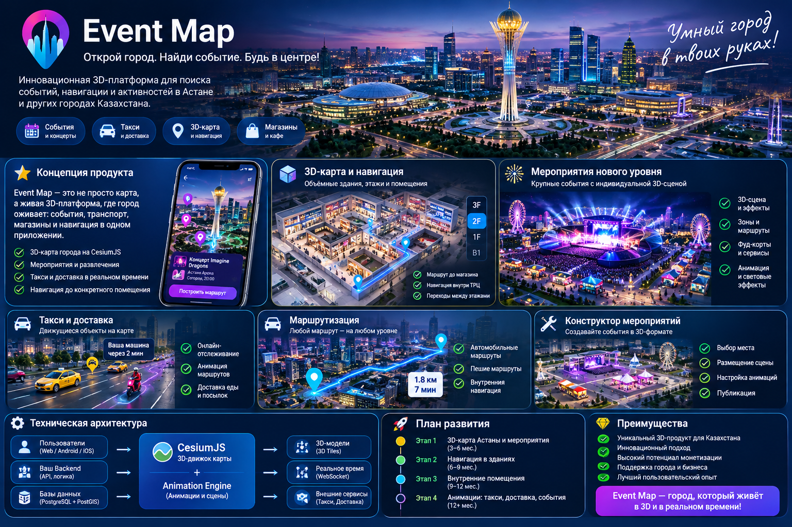

# EVENT MAP — Product Vision & Technical Architecture (долгосрочное направление)

> Источник: обсуждение владельца с ChatGPT 17.11.2026 («Сравнение сложности продуктов»). Перенесено в репозиторий без смысловых правок.
>
> Это **направление развития существующего Event Map, а не утверждённый план и не задание переписать проект**. Выбор CesiumJS — гипотеза, она требует проверки (см. `05_Docs/AUDIT_3D_MAP_2026-11-17.md`, когда он появится).
>
> Постер `vision/event-map-poster.png` — AI-иллюстрация цели, а не снимок продукта или Cesium.



## 1. Концепция продукта

Event Map — интерактивная геопространственная платформа нового поколения. Она объединяет 2D/3D-карты, мероприятия, городскую инфраструктуру, транспорт, коммерческие объекты и навигацию внутри зданий.

Главная идея — карта должна быть не просто инструментом просмотра местоположения, а полноценной цифровой моделью городской среды.

Что может пользователь:

- Посмотреть карту города в 2D и 3D.
- Найти мероприятие, концерт, фестиваль или выставку.
- Увидеть не только здание, но и территорию конкретного мероприятия.
- Построить маршрут до нужного здания.
- Найти конкретный магазин или кафе внутри здания.
- Получить маршрут до нужного помещения, включая этажи.
- Наблюдать за движением такси и доставки, если есть соответствующие интеграции.
- Пользоваться интерактивными 3D-сценами крупных мероприятий.

Долгосрочная цель — единая цифровая карта городской жизни, где пространство, события, бизнес и перемещение людей связаны между собой.

## 2. Основные направления продукта

### 2.1. 3D-карта города

Как основа развития рассматривается CesiumJS.

Возможности:

- Трёхмерное отображение города и 3D-здания.
- Реалистичный рельеф.
- Спутниковые и картографические слои.
- Интерактивные объекты.
- Мероприятия и коммерческие объекты на карте.
- Камера с переходами от общего вида города к конкретному объекту.
- Маршруты и движущиеся объекты.

Важно: CesiumJS — движок геопространственной визуализации. Полную базу зданий, помещений и маршрутов он сам не даёт: для этого нужны отдельные данные и сервисы.

### 2.2. Мероприятия и события

Каждое мероприятие — самостоятельный географический объект.

Категории: концерты, фестивали, спортивные мероприятия, выставки, ярмарки, марафоны, городские праздники, распродажи, развлекательные мероприятия, локальные события.

У каждого мероприятия должны быть:

- название и описание;
- дата и время;
- координаты и территория проведения;
- организатор;
- фотографии и видео;
- категория;
- ссылка на билеты;
- 2D/3D-визуализация;
- маршруты до площадки.

## 3. Indoor Navigation — навигация внутри зданий

Это одна из ключевых отличительных особенностей будущего Event Map. Обычная карта показывает здание, а Event Map со временем должна показывать, что находится внутри.

Пример: пользователь ищет кофейню в торговом центре. Система должна:

1. Найти кофейню.
2. Определить, где она находится в здании.
3. Показать этаж.
4. Построить маршрут от входа.
5. Провести по коридорам.
6. Показать лестницы, лифты и эскалаторы.
7. Довести до нужного помещения.

```
Building
 ├── Floor 1
 │    ├── Shop 101
 │    ├── Cafe 102
 │    ├── Restaurant 103
 │    └── Corridor
 ├── Floor 2
 │    ├── Shop 201
 │    ├── Cinema
 │    └── Food Court
 └── Floor 3
      ├── Offices
      └── Entertainment Zone
```

Компоненты: Building, Floor, IndoorSpace, Shop, Entrance, Corridor, Elevator, Escalator, Staircase, IndoorPOI.

Для настоящей внутренней маршрутизации нужен граф проходимых пространств: маршрут не должен проходить сквозь стену или закрытое помещение. Алгоритмы — Dijkstra или A*. Этажи связываются через лестницы, лифты и эскалаторы.

## 4. Маршрутизация

Маршрутизация строится в несколько уровней:

1. Городская: автомобиль, пешком, велосипед, другие способы.
2. До правильного входа, а не до центра здания.
3. Внутри здания.
4. Между этажами.
5. До конечной точки: магазина, кафе, ресторана, зала или мероприятия.

| Технология | Назначение |
|---|---|
| CesiumJS | Маршруты в 3D |
| OSRM | Внешняя маршрутизация |
| Valhalla | Альтернативный routing engine |
| PostGIS | Пространственные данные |
| A* / Dijkstra | Маршрут внутри здания |

Конкретный выбор зависит от покрытия дорожных данных, лицензий и требований к маршрутам.

## 5. Taxi & Delivery Animation

На карте можно показывать такси, курьеров, доставку еды и товаров, сервисные автомобили и транспорт мероприятий.

Как это работает:

1. Координаты приходят из разрешённого источника.
2. Передаются на backend.
3. Положение объекта обновляется.
4. Маршрут строится или обновляется.
5. Движение плавно анимируется.
6. Показывается статус.

```
Taxi
 ├── ID
 ├── CurrentLocation
 ├── Destination
 ├── Route
 ├── Speed
 ├── Direction
 ├── Status
 └── UpdatedAt
```

Обновления передаются через WebSocket.

Без реальной интеграции с транспортным сервисом допустимы только демонстрационные симуляции, явно помеченные как симуляции.

## 6. Event Scene Engine — индивидуальные сцены мероприятий

Крупные мероприятия получают собственные интерактивные 3D-сцены. Вместо маркера пользователь открывает 3D-модель площадки.

Что на ней может быть: главная сцена, LED-экраны, зоны зрителей, VIP-зоны, фуд-корт, торговые павильоны, входы и выходы, парковки, туалеты, медпункты, информационные стойки, пешеходные маршруты.

Анимации: транспорт, подсветка сцены, световые эффекты, анимированные указатели, подсветка маршрутов, временные зоны, анимированные элементы мероприятия.

| Уровень | Возможности |
|---|---|
| S | Обычная точка мероприятия |
| M | Территория, зоны, входы и выходы |
| L | Полноценная индивидуальная 3D-сцена |

Дорогая индивидуальная модель нужна не каждому мероприятию: большинство обслуживается стандартными шаблонами.

## 7. Animation Engine

```
AnimationEngine
 ├── TransportAnimation
 ├── RouteAnimation
 ├── EventSceneRuntime
 ├── ObjectAnimation
 ├── EffectsLayer
 ├── TimelineController
 └── InteractionController
```

Задачи модуля: движущиеся объекты, анимация маршрутов, сцены мероприятий, загрузка 3D-моделей, визуальные эффекты, синхронизация анимаций с событиями, обработка взаимодействий.

Сцены описываются конфигурациями и данными, а не пишутся вручную в коде под каждый концерт.

## 8. Event Builder — конструктор мероприятий

Как организатор создаёт площадку:

1. Создаёт мероприятие.
2. Выбирает территорию.
3. Добавляет сцену.
4. Размещает зоны.
5. Добавляет входы и выходы.
6. Размещает торговые павильоны.
7. Настраивает визуализацию.
8. Добавляет анимации.
9. Публикует.

Для начала хватит административного конструктора с готовыми шаблонами. Полноценный 3D-редактор — позже.

## 9. Предлагаемая техническая архитектура (предварительная)

**Frontend:** существующий frontend, CesiumJS Viewer, Map Layer Manager, Event Layer, POI Layer, Route Renderer, Indoor Renderer, Animation Engine, Event Scene Runtime.

**Backend:** Authentication, Users, Events, Organizers, Places, Buildings, Indoor Navigation, Routing API, Live Location, Scene Configuration.

**Database:** PostgreSQL, PostGIS, Object Storage, Redis при необходимости.

**Геоданные и 3D:** GeoJSON, 3D Tiles, 3D-модели зданий и помещений, данные этажей, геометрия маршрутов.

| Технология | Роль |
|---|---|
| CesiumJS | Основная 3D-визуализация |
| Three.js | Дополнительные 3D-эффекты |
| PostGIS | Пространственная база |
| GeoJSON | Обмен геоданными |
| 3D Tiles | Большие 3D-модели |
| OSRM / Valhalla | Внешняя маршрутизация |
| WebSocket | Движение объектов в реальном времени |

Весь стек сразу использовать не обязательно.

## 10. Модель данных

Сущности:

- Event, EventVenue, EventZone, EventScene, SceneAsset, SceneObject, AnimationDefinition.
- Place, Building, Floor, IndoorSpace, Entrance, Connector, WalkableSegment.
- Route, RouteNode, RouteEdge.
- LiveObject, LivePosition.
- Organizer.

События, помещения, здания и маршруты должны связываться между собой. Например, событие может проходить в конкретном здании, на определённом этаже и в определённом помещении.

## 11. Этапы

- **0. Аудит:** репозиторий, архитектура, карта, backend, API, БД; проверка интеграции CesiumJS.
- **1. 3D Event Map MVP:** 3D-карта, здания, события, POI, фильтры, маршруты до мест проведения.
- **2. Event Zones:** территории мероприятий, сцены, входы, выходы, зоны, сервисные объекты.
- **3. Indoor Navigation:** пилотный торговый центр, этажи, магазины, кафе, маршруты до помещений.
- **4. Live Transport:** такси, курьеры, доставка, GPS-обновления и анимация.
- **5. Event Scene Engine:** индивидуальные 3D-сцены, анимации, конструктор мероприятий.

## 12. Монетизация (гипотезы, требуют проверки на клиентах)

1. Подписка для торговых центров.
2. Подписка для организаторов.
3. Продвижение концертов и фестивалей.
4. Платное размещение коммерческих объектов.
5. Indoor-навигация для крупных зданий.
6. Индивидуальные 3D-сцены крупных мероприятий.
7. B2B-интеграции с транспортными и коммерческими сервисами.
8. Агрегированная аналитика использования карты с соблюдением приватности.

## 13. Главные технические риски

- Нет качественных 3D-данных.
- Планы этажей нужно получать от владельцев зданий.
- Точная indoor-навигация сложна.
- Производительность на мобильных устройствах.
- Индивидуальные 3D-сцены дорого готовить.
- Нет API с реальными координатами транспорта.
- CesiumJS сложно интегрировать с существующим frontend.

Решение: не строить всю платформу сразу. Начать с работающего прототипа и одного пилотного здания.

## 14. Правила для AI-разработчика (DEVELOPMENT RULES — EVENT MAP)

1. **Не переписывать проект с нуля.** Сначала изучить репозиторий: структуру, frontend и backend, текущую карту, API, БД, авторизацию, готовые функции и незавершённые задачи. Составить технический аудит:
   - что работает;
   - что сделано частично;
   - чего нет;
   - что переиспользовать;
   - что менять.
2. **CesiumJS — основной кандидат** для 3D-геовизуализации. Не считать, что Cesium сам даёт маршрутизацию, планы этажей, базу магазинов, внутреннюю навигацию или реальные координаты транспорта.
3. **Будущие модули:** CityMap3D, EventLayer, POILayer, RoutingEngine, IndoorNavigation, BuildingModel, FloorManager, TransportLayer, AnimationEngine, EventSceneRuntime, EventBuilder. Создавать сразу все не нужно: границы определяются по существующей архитектуре.
4. **Работа с кодом:**
   - сохранять работающее;
   - не удалять модули без необходимости;
   - не дублировать сервисы;
   - не добавлять фиктивные API;
   - не выдавать демо-данные за реальные;
   - не менять стек без технического обоснования;
   - сохранять обратную совместимость.
5. **Перед крупной задачей:**
   1. Изучить затрагиваемые модули.
   2. Определить зависимости.
   3. Предложить архитектурное решение.
   4. Перечислить изменяемые файлы.
   5. Описать изменения API и БД.
   6. Описать тесты.
   7. Указать риски и способ отката.

   **После реализации:**
   - прогнать тесты;
   - проверить сборку и существующие функции;
   - обновить документацию;
   - зафиксировать технические решения.
6. **Приоритет** — аудит и интеграция 3D-карты без поломки текущего Event Map. Не начинать одновременно indoor-навигацию, транспорт и сложные анимации: сначала стабильный фундамент.

## 15. Документация

CesiumJS, Cesium 3D Tiles, Cesium ion, PostGIS, OSRM, Valhalla, Three.js.

## 16. Итог

Event Map должна постепенно стать платформой, которая связывает город, здания, помещения, магазины, кафе, мероприятия, концерты, транспорт, доставку, маршруты и 3D-сцены.

Главное конкурентное направление — навигация не до здания, а до конкретного места внутри него, плюс 3D-визуализация всей инфраструктуры мероприятия. Это долгосрочное видение: в первой версии всё сразу не делается.
